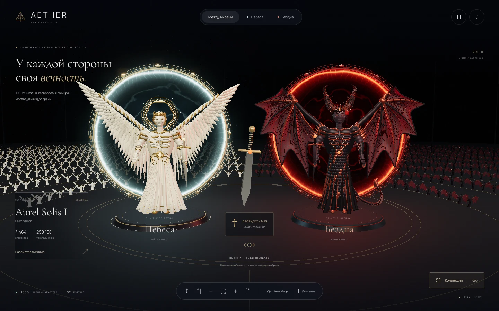

# AETHER

**A cinematic journey through light, flight, and the heavens.**

[Experience AETHER](https://bekasyl00.github.io/aether-celestial-experience/) · [Source](https://github.com/bekasyl00/aether-celestial-experience)



A scroll-driven creative development project by **Bekassyl Zhaksylyk**. Move from a marble angel at sunrise into a field of floating feathers, unfolding wings, and a luminous celestial gateway.

## The experience

- Real-time Three.js wings built from feather meshes, a dimensional portal, and drifting particles.
- Scroll-linked scene progression, camera movement, layered artwork, and GSAP typography reveals.
- An optional ambient soundscape synthesized in the browser with Web Audio. Sound starts only after you enable it.
- Responsive layouts, chapter navigation, a motion toggle, and support for the system's reduced-motion preference.
- A readable visual fallback when WebGL is unavailable, with locally served fonts and artwork.

The cinematic angel and cloudscape backdrops are **generated still images**. The wings, feather geometry, portal, particles, and camera animation are **real-time 3D** rendered over those images. This combination gives the scene its cinematic scale while keeping the interactive geometry procedural. Asset provenance is recorded in [ASSETS.md](ASSETS.md).

## Built with

Vanilla JavaScript, Vite, Three.js, GSAP, CSS, and the Web Audio API. Cormorant Garamond and Manrope are self-hosted through Fontsource. There is no application backend.

## Run locally

Use Node.js 22.12+.

```bash
npm ci
npm run dev
```

Open the Vite URL shown in the terminal. The project is configured under `/aether-celestial-experience/`, including during local development.

```bash
npm run check
npm run build
npm run preview
```

`check` validates JavaScript syntax. It is not a browser, accessibility, or performance test.

Run the browser smoke suite:

```bash
npx playwright install chromium
npm test
```

The suite starts Vite automatically. On macOS it can reuse an installed Google Chrome. `PLAYWRIGHT_BASE_URL` targets an existing preview or the live deployment.

## Project map

| File | Responsibility |
| --- | --- |
| `index.html` | Story, navigation, and accessible controls |
| `src/main.js` | Scroll progression, reveals, controls, and scene loading |
| `src/scene.js` | Procedural Three.js geometry and rendering |
| `src/audio.js` | Optional synthesized ambience |
| `src/style.css` | Typography, composition, responsive layouts, and motion preferences |
| `public/images/` | Generated cinematic backdrops |
| `DESIGN.md` | Visual direction |

## Deployment and verification

GitHub Actions installs the locked dependencies, checks syntax, builds the static site, and deploys `dist` to GitHub Pages on pushes to `main`. The workflow also supports manual runs. The Vite base path matches the repository name.

Local release checks: production build and syntax checks passed; **14 browser smoke tests passed** across desktop and mobile Chromium. The tests cover actual WebGL draw calls, chapter navigation, overflow, gesture-only audio, replay/focus, motion controls, reduced motion, and WebGL fallback. The rendered design was reviewed at 1440×900 and 390×844; missing-image fallback and keyboard skip navigation were also exercised.

The live deployment is published by the [Deploy AETHER workflow](https://github.com/bekasyl00/aether-celestial-experience/actions/workflows/deploy.yml).

## Credits and license

Created by **Bekassyl Zhaksylyk** with AI-assisted development and image generation.

Authored source code is available under the [MIT License](LICENSE). Generated images, third-party fonts, and dependencies are documented separately in [ASSETS.md](ASSETS.md); they are not relicensed by the project's MIT license.
